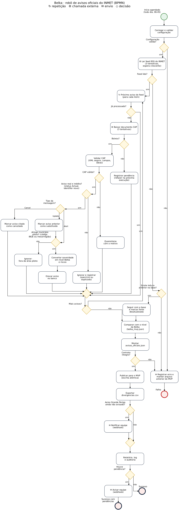

# Belka · RPA · Avisos oficiais do INMET

**Olhar longe. Proteger perto.**

Este repositório contém o componente de **Automação (RPA)** da Belka, startup CitizenTech de alerta antecipado contra
enchentes, deslizamentos, calor extremo, tempo seco e vento forte. O robô lê todos os dias os **avisos meteorológicos
oficiais do INMET**, descobre quais atingem os municípios piloto, converte a severidade oficial para os níveis da
Belka, publica o resultado para o MVP e **compara com o nível que a Belka calculou**, apontando à equipe onde o modelo
ficou abaixo do aviso oficial.

> Os níveis da Belka são **indicadores experimentais** e não substituem os alertas oficiais da Defesa Civil.
> Os avisos do INMET são reproduzidos sem alteração de conteúdo.

- MVP da Belka (consome a saída deste robô): [Belka AI](https://belka-api.salmonisland-04dfa6a6.brazilsouth.azurecontainerapps.io/)
- Vídeo de apresentação: _adicionar link_

## Integrantes

| Nome completo | RM |
|---|---|
| Fernanda Kaory Saito | 551104 |
| João Pedro Borsato | 550294 |
| Maria Fernanda Camargo | 97956 |
| Pedro Lucas Nunes | 550366 |

## 1. O problema operacional

O MVP diz ao cidadão que os níveis da Belka não substituem os avisos oficiais, mas não mostrava esses avisos. Para
mostrar e conferir, alguém da equipe teria que fazer isto à mão, todo dia:

| # | Tarefa manual (antes) | Risco |
|---|---|---|
| 1 | Abrir o portal de avisos do INMET e procurar os 5 municípios piloto em dezenas de avisos | Aviso esquecido; a área vem por mesorregião e é fácil confundir |
| 2 | Abrir cada aviso, ver severidade, início e fim, e copiar para o MVP | Erro de digitação; aviso cancelado ou atualizado continua no ar |
| 3 | Traduzir "Perigo Potencial / Perigo / Grande Perigo" para os níveis da Belka | Cada pessoa interpreta de um jeito |
| 4 | Comparar com o nível calculado pela Belka e avisar a equipe quando o modelo errar para menos | Ninguém faz; o modelo não é recalibrado |

## 2. A solução

Um robô em Python (`belka_avisos/`) que roda sozinho pela linha de comando ou **todo dia às 06:45** por um agendador
(DAG do Airflow em `agendamento/`, cron ou Agendador de Tarefas do Windows):

```
Feed RSS do INMET ──► para cada aviso: baixar o CAP ──► validar ──► cancelamento / atualização / novo?
   ──► atinge município piloto? (código IBGE) ──► severidade → nível Belka ──► banco SQLite
   ──► comparação com belka_mvp.json ──► saida/avisos_oficiais.json (MVP) ──► divergencias.csv
   ──► aviso grave → equipe (webhook) ──► relatório, log e auditoria
```

### Fonte de dados

| Fonte | Endereço | Formato |
|---|---|---|
| INMET · avisos meteorológicos | `https://apiprevmet3.inmet.gov.br/avisos/rss` | RSS; cada item aponta para um documento **CAP 1.2** (Common Alerting Protocol, padrão OASIS) |

Cada documento CAP traz `identifier`, `msgType` (Alert, Update, Cancel), `references`, `event`, `severity`, `onset`,
`expires`, a cor do aviso (`ColorRisk`), a lista `Municipios` no formato `São Paulo - SP (3550308)` e a área por
mesorregião (`areaDesc`). Não é preciso chave de API e a fonte não tem dado pessoal.

### Fluxo BPMN

<p align="center"></p>

O BPMN editável está em [`docs/belka_avisos.bpmn`](docs/belka_avisos.bpmn) (abra em [bpmn.io](https://demo.bpmn.io)
ou no Camunda Modeler). Ele e a imagem saem da mesma definição: `python docs/gerar_bpmn.py` (requer o Graphviz).

### Etapas

| Etapa | O que faz | Decisão / repetição |
|---|---|---|
| E1 Configuração | Lê `config/config_avisos.json` e valida municípios e tabelas | Inválida → **FALHA** |
| E2 Feed | Lê o RSS do INMET (3 tentativas, espera de 2 s, 4 s) | Caiu → há leitura anterior? Sim: segue com a base e marca a fonte como desatualizada. Não: **FALHA** |
| E3 Avisos | **Para cada item** do feed, do mais antigo ao mais novo | Já processado → pula sem baixar de novo |
| | Baixa o CAP (3 tentativas) | Não baixou → pendência, refaz na próxima execução |
| | Valida o CAP (XML seguro, campos obrigatórios, datas com fuso, fim depois do início) | Inválido → quarentena com o motivo |
| | Confere se é real e inédito | `status` diferente de `Actual` (exercício, teste) ou `identifier` repetido → ignora |
| | Tipo da mensagem | `Cancel` → cancela o aviso citado · `Update` → substitui o anterior · `Alert` → aviso novo |
| | Área | Nenhum município piloto na lista (ou na mesorregião, se a lista faltar) → ignora |
| | Severidade | Converte para o nível Belka; sem nenhum sinal reconhecível → quarentena |
| E4 Comparação | Lê o nível da Belka em `entrada/belka_mvp.json` e compara com o aviso oficial do mesmo dia | Arquivo ausente → publica sem comparação (pendência) |
| E5 Publicação | Monta `saida/avisos_oficiais.json` e valida o contrato | Reprovado → **FALHA**, arquivo anterior mantido |
| E6 Divergências | Exporta `saida/divergencias.csv` | Belka abaixo do oficial → "revisar limiares" |
| E7 Avisos graves | Aviso Grande Perigo vigente ou próximo | Ainda não avisado → webhook para a equipe (uma vez só) |
| E8 Fechamento | Relatório JSON, log, auditoria e registro no banco | Pendência ou falha → webhook |

## 3. Regras de negócio

**Severidade oficial → nível da Belka** (o mesmo `equivalente_inmet` do MVP):

| INMET (grau) | CAP `severity` | Cor | Nível Belka |
|---|---|---|---|
| Perigo Potencial | Moderate | amarelo | 1 · Fique de olho |
| Perigo | Severe | laranja | 2 · Prepare-se |
| Grande Perigo | Extreme | vermelho | 3 · Aja agora |

O robô usa três sinais do mesmo aviso: `severity`, a cor e o grau escrito no título. Se discordarem, vale o mais grave
e o conflito vai para o log. Basta um sinal reconhecido; nenhum → quarentena.

**Evento → riscos da Belka:**

| Evento do INMET | Riscos |
|---|---|
| Tempestade | enchente, vento forte |
| Chuvas Intensas, Acumulado de Chuva | enchente, deslizamento |
| Vendaval, Ventos Costeiros | vento forte |
| Baixa Umidade | tempo seco |
| Onda de Calor | calor extremo |
| outros (geada, frio, ressaca...) | outro |

**Situação do aviso** em relação à hora de referência: `vigente` (já começou e não terminou), `proximo` (começa em até
3 dias), `expirado` (fica só no histórico) ou `fora_do_horizonte`.

**Comparação com a Belka**, por município, no último dia do snapshot da Belka: `concorda`, `belka_abaixo` (o aviso
oficial foi mais grave: revisar limiares) ou `belka_acima` (a Belka antecipou um risco local). Se o robô ainda não
tiver avisos registrados que cubram aquele dia, a comparação sai como indisponível, sem inventar resultado.

Tabelas, municípios piloto, horizonte e nível mínimo para notificar ficam em `config/config_avisos.json`: a equipe
ajusta a regra sem mexer no código.

## 4. Integração com o MVP

| Saída | Quem consome | Conteúdo |
|---|---|---|
| `saida/avisos_oficiais.json` | Tela do cidadão (MVP) | Por município: nível oficial agora, avisos vigentes e próximos (título, descrição, instrução, link do INMET), comparação com a Belka e situação da fonte |
| `saida/belka_avisos.db` (SQLite) | Assistente Belka AI, painel da Defesa Civil | `avisos`, `aviso_municipio`, `itens_rss`, `execucoes`, `notificacoes` |
| `saida/divergencias.csv` | Equipe de dados da Belka | Onde o modelo ficou abaixo ou acima do aviso oficial |

Entrada vinda do pipeline de dados: `entrada/belka_mvp.json`, o snapshot que o MVP já usa (o caminho é configurável
em `entrada_belka_mvp`).

Chaves de `avisos_oficiais.json`:

| Chave | Uso no MVP |
|---|---|
| `municipios[].nivel_oficial_agora`, `grau_inmet` | Selo "aviso oficial" ao lado do nível da Belka |
| `municipios[].avisos_vigentes[]` | Cartões com título, descrição, instrução e link do INMET |
| `municipios[].proximos_avisos[]` | "Nos próximos dias" |
| `comparacao_belka` | "A Belka e o INMET concordam?" |
| `fonte.desatualizada`, `fonte.ultima_leitura_ok` | Aviso na tela quando o INMET não respondeu |
| `aviso_legal` | Texto fixo com Defesa Civil (199) e Bombeiros (193) |

## 5. Exceções e resiliência

| Situação | O que o robô faz |
|---|---|
| Feed do INMET fora do ar | 3 tentativas com espera crescente; com base anterior, publica marcando `fonte.desatualizada`; sem base, **FALHA** sem publicar |
| Feed vazio, HTML de manutenção ou XML quebrado | Tratado como feed indisponível (mesma decisão acima) |
| Um CAP não baixa | Pendência; o item é refeito na próxima execução, os outros seguem |
| CAP corrompido, sem campo obrigatório ou com datas incoerentes | Quarentena em `saida/quarentena/<execução>/` com o XML e o motivo |
| XML com entidades externas (ataque XXE) | Recusado pelo `defusedxml` e enviado para a quarentena |
| Severidade não reconhecida | Quarentena |
| Sinais de severidade em conflito (dado inconsistente) | Usa o mais grave e registra no log |
| Entrada da lista de municípios fora do padrão | Descartada e contada no log |
| CAP sem lista de municípios | Usa a mesorregião de `areaDesc` e avisa que é menos preciso |
| Mesmo aviso em dois itens do feed | Ignorado pelo `identifier` |
| Cancelamento que chega antes do aviso | Guardado e aplicado quando o aviso chegar |
| Robô rodando de novo | Itens já processados nem são baixados; nada duplica |
| `belka_mvp.json` ausente ou inválido | Publica os avisos sem comparação e registra pendência |
| Arquivo do MVP reprovado na validação | **FALHA**, o arquivo anterior continua publicado |
| Erro inesperado num aviso | Registrado com o tipo do erro; o lote continua |

Nenhuma falha é silenciosa: tudo vira evento de auditoria, entra no relatório e define o status final
(`SUCESSO`, `SUCESSO_COM_PENDENCIAS` ou `FALHA`).

## 6. Logs e auditoria

| Arquivo | Conteúdo |
|---|---|
| `logs/belka_avisos_<execução>.log` | Data/hora, nível, etapa, resultado, item e mensagem |
| `logs/auditoria.jsonl` | Um evento JSON por linha, acumulado entre execuções |
| `saida/relatorios/relatorio_<execução>.json` | Itens por situação, decisões, comparação, publicação, notificações, pendências e duração |
| `saida/ultima_execucao.json` | Cópia do último relatório, para monitoramento |
| tabela `execucoes` no SQLite | Histórico de todas as execuções com status |

Trecho real (`evidencias/cenarios/01_sucesso_e_decisoes/execucao.log`):

```
2026-11-18 20:32:39-0300 | INFO    | aviso_cap    | ok        | 55902 | Chuvas Intensas · Perigo -> Prepare-se (severity+cor+titulo) · São Sebastião · vigente
2026-11-18 20:32:39-0300 | INFO    | decisao      | decisao   | 55906 | urn:oid:2.49.0.0.76.0.2026.55905.1 -> cancelado
2026-11-18 20:32:39-0300 | INFO    | comparacao   | ok        | 2026-11-07 | belka_abaixo: 1, concorda: 4
2026-11-18 20:32:39-0300 | WARNING | divergencia  | aviso     | São Sebastião | Belka Fique de olho x INMET Prepare-se em 2026-11-07: revisar limiares
```

## 7. Segurança e LGPD

- A fonte é pública e não tem dado pessoal. O robô trabalha **por município**: não lê nem grava nome, telefone ou e-mail
  de cidadão.
- A URL do webhook vem só de variável de ambiente (`.env`, fora do Git). Não há chave nem senha no repositório.
- Todo texto que vai para o log passa por `sanitizar()`, que mascara tokens, senhas, e-mails, telefones, URLs com
  credenciais e caminhos de webhook (há teste automatizado para isso).
- O XML externo é lido com `defusedxml` (bloqueia XXE e "bomba de entidades") e respostas acima de 5 MB são recusadas.
- O arquivo do MVP é gravado de forma atômica e a versão anterior é guardada em `avisos_oficiais.anterior.json`.

## 8. Como executar

Requisitos: Python 3.10 ou mais novo.

```bash
pip install -r requirements.txt

# na raiz do repositório
python -m belka_avisos                         # produção: lê o feed do INMET agora
python -m belka_avisos --local exemplos/feed_2026-11-07 --agora 2026-11-07T15:00:00-03:00   # demonstração offline
python -m belka_avisos --estrito               # código de saída 1 se houver pendências
```

Códigos de saída: `0` sucesso (com ou sem pendências), `1` pendências em modo estrito, `2` falha.

`exemplos/feed_2026-11-07/` é uma cópia de feed no **formato real do INMET**, com conteúdo ilustrativo escrito para
exercitar todas as regras (vigente, laranja, fora da área, cancelamento, atualização, exercício e Grande Perigo), na
data do último dia do snapshot da Belka em `entrada/`. Para recriá-la: `python exemplos/montar_feed_exemplo.py`.

Para avisar a equipe no Teams/Slack/n8n, copie `env.example` para `.env` e defina `BELKA_WEBHOOK_URL`.

### Agendamento

| Opção | Como |
|---|---|
| Airflow 3 | Monte este repositório em `/opt/airflow/belka-rpa-avisos` e copie `agendamento/belka_avisos_dag.py` para `dags/` (todo dia às 06:45, com nova tentativa) |
| cron (Linux/macOS) | `45 6 * * * cd /caminho/belka-rpa-avisos && python -m belka_avisos` |
| Windows | Agendador de Tarefas: programa `python`, argumentos `-m belka_avisos`, iniciar em `C:\caminho\belka-rpa-avisos` |

## 9. Testes e validação

```bash
python -m pytest -v          # 51 testes: regras, sucesso, decisão e falha
python demo_cenarios.py      # roda 5 cenários completos e guarda as evidências
```

| Cenário | Tipo | Resultado esperado | Evidência |
|---|---|---|---|
| 01 Feed de 07/11 com todos os tipos de aviso | Sucesso e decisão | `SUCESSO`; São Sebastião em Prepare-se, cancelamento e atualização aplicados, exercício e área externa ignorados, divergência apontada | `evidencias/cenarios/01_sucesso_e_decisoes/` |
| 02 Mesmo feed outra vez | Sucesso (idempotência) | 10 itens já processados, nada baixado nem duplicado | `evidencias/cenarios/02_idempotencia/` |
| 03 INMET fora do ar depois de uma leitura | Falha recuperável | 3 tentativas, publica da base com `fonte.desatualizada = true` | `evidencias/cenarios/03_inmet_fora_do_ar_com_base/` |
| 04 CAP corrompido, sem severidade e indisponível | Falha recuperável | 2 na quarentena, 1 pendência para refazer, o resto publicado | `evidencias/cenarios/04_dados_invalidos/` |
| 05 INMET fora do ar na primeira execução | Falha crítica | `FALHA`, código 2, nada publicado | `evidencias/cenarios/05_falha_sem_base/` |

A saída completa do pytest está em `evidencias/testes_pytest.txt`.

**Execução contra o feed real do INMET** (`evidencias/execucao_inmet_real.log`, 19/11/2026): 65 avisos lidos em
7,5 s, status `SUCESSO`. 5 avisos de Tempestade atingiam os municípios piloto (Perigo Potencial → Fique de olho),
20 foram ignorados por estarem fora da área e os cancelamentos de avisos que já tinham saído do feed foram
registrados sem quebrar a execução. A comparação saiu como indisponível porque o snapshot da Belka ia até 07/11.

## Documentação em PDF

`docs/Belka_RPA_Documentacao.pdf` reúne processo, BPMN, regras, exceções, logs, integração, testes e a execução
real. Ele é gerado a partir das evidências, então sempre bate com a última execução. Para colocar os links:

```bash
pip install reportlab pillow
python docs/gerar_documentacao.py --github https://github.com/USUARIO/belka-rpa-avisos --video https://youtu.be/XXXX
```

## 10. Estrutura

```
belka_avisos/
├── robo.py          orquestração E1–E8 (o mesmo desenho do BPMN)
├── fonte.py         feed do INMET e cópia local, com novas tentativas
├── cap.py           leitura segura do RSS e dos documentos CAP 1.2
├── regras.py        severidade → nível Belka, evento → riscos, área, situação, comparação
├── banco.py         SQLite: idempotência, estados dos avisos, notificações, execuções
├── publicacao.py    avisos_oficiais.json, validação do contrato, divergências
├── auditoria.py     log, eventos JSON e máscara de dados sensíveis
└── __main__.py      linha de comando
config/config_avisos.json   regras de negócio e parâmetros
entrada/belka_mvp.json      snapshot da Belka usado na comparação (vem do pipeline de dados)
exemplos/                   feed de exemplo no formato do INMET e o script que o monta
tests/                      51 testes automatizados
docs/                       BPMN (.bpmn, .png, .svg), documentação em PDF e os geradores
evidencias/                 logs, relatórios e saídas dos cenários
agendamento/                DAG do Airflow (opcional)
demo_cenarios.py            demonstração dos 5 cenários
```

## Fontes

- INMET, Avisos meteorológicos: https://apiprevmet3.inmet.gov.br/avisos/rss
- OASIS, Common Alerting Protocol 1.2: https://docs.oasis-open.org/emergency/cap/v1.2/CAP-v1.2-os.html
